# agent-trace

Universal text transcript CLI for agent/harness sessions. Output is text only — no HTML, no TUI.

Useful for inspecting agent runs, debugging what happened, and evaluating results — including handing a transcript to another agent for review.

Implemented in Python using only the standard library.

## Supported harnesses

- Claude Code
- Codex
- Cursor
- Pi



## Installation

With [uv](https://docs.astral.sh/uv/):

```bash
uv tool install git+https://github.com/ertygiq/agent-trace.git
```

## Usage

```bash
agent-trace --harness <harness> --session <session-id> <filters...>
```

Three things to specify:

- **`--harness`** — which harness produced the session: `claude-code` (aliases: `cc`, `claude`), `codex`, `cursor`, or `pi`.
- **`--session`** — the session id to read.
- **filters** — what to include in the output (at least one required, see below).

Add `--json` for machine-readable output (see [JSON output](#json-output)). In text output, the first displayed entry on each date includes the day and month; later entries on that date show only the time.

```bash
agent-trace --harness claude-code --session abc123 --human --assistant
```

## Filters

Filters select which event categories appear in the transcript. At least one is required; multiple filters combine as a union (OR).

| Filter | Shows |
| --- | --- |
| `--human` | Human-authored messages (alias: `--user`) |
| `--assistant` | Assistant text messages |
| `--thinking` | Assistant thinking blocks |
| `--bash-command` | Bash command text |
| `--bash-output` | Bash command output |
| `--bash-description` | Harness-provided description for a Bash command, when available |
| `--bash` | Shortcut for the three `--bash-*` filters |
| `--all` | All supported categories |

Only shell tool calls are shown. Other tool calls — file reads, edits, writes, searches — are
skipped for every harness; `--all` means all categories in the table above, not every event in
the session file.

Not every harness records every category. For Cursor, agent-trace prefers the IDE's local state
database, which retains separate thinking blocks and assistant timestamps, then falls back to the
portable JSONL transcript. Cursor's JSONL is less detailed: it can merge thinking with assistant
text and omit timestamps and tool results.

```bash
# human + assistant messages
agent-trace --harness codex --session abc123 --human --assistant

# thinking + bash commands
agent-trace --harness claude-code --session abc123 --thinking --bash-command

# everything bash: description, command, and output
agent-trace --harness claude-code --session abc123 --bash
```

## JSON output

`--json` prints a JSON array instead of text. Entries carry the same three fields for every
harness — they describe agent-trace's own categories, not the source transcript's structure — so
a consumer can treat all harnesses identically.

| Field | Value |
| --- | --- |
| `type` | The filter category: `human`, `assistant`, `thinking`, `bash_description`, `bash_command`, `bash_output` |
| `timestamp` | The timestamp as the harness recorded it, or `null` when it records none |
| `text` | The message, command, or output text |

```bash
agent-trace --harness cursor --session abc123 --all --json
```

```json
[
  {
    "type": "human",
    "timestamp": "Monday, May 11, 2026, 2:07 PM (UTC+1)",
    "text": "follow instructions in weekly_analysis_workflow.md"
  },
  {
    "type": "bash_command",
    "timestamp": "2026-05-11T13:07:18.221Z",
    "text": "git diff task_hub.md"
  }
]
```

Entries appear in transcript order, and the array is empty (`[]`) when nothing matches. Timestamp
*values* are passed through verbatim rather than normalized, since harnesses record them in
different formats — Claude Code and Codex use ISO-8601; Cursor's database uses ISO-8601 while
its fallback JSONL stores human-readable timestamps on user turns only.

## Harness data roots

Each harness has a default location agent-trace reads from:

- `claude-code`: `~/.claude`
- `codex`: `~/.codex`
- `cursor`: `~/.cursor` for JSONL transcripts; the platform Cursor user-data directory for the preferred `globalStorage/state.vscdb` source
- `pi`: `~/.pi`

Use `--root` to override the default — for example, to read sessions from another machine's exported data. The path may be either the harness config directory or the directory that directly contains session/project folders. For Cursor, it may also be a Cursor user-data directory, its `User` or `globalStorage` directory, or a directory containing `state.vscdb`. Database extraction uses an undocumented Cursor schema and may require updates after Cursor releases; agent-trace opens it read-only and falls back to JSONL when it is absent or unsupported.

```bash
agent-trace --harness codex --session abc123 --root /path/to/.codex --bash-command
agent-trace --harness claude-code --session abc123 --root /path/to/.claude --human
```
